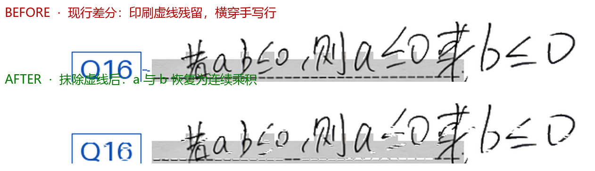

# 01 · 差分 vs 不差分

> **样本来源**：本目录两份卷都是教师为验证流程自行打印的测试卷，作答笔迹为**教师本人**书写，卷头学校名取自打印模板标题（已遮盖）。不含任何真实学生数据；下文「学生卷」「学生写」指"被批阅方"这一角色，不代表样本来自真实学生。

同一份卷，只替换输入图像，模型、提示词、温度、思考开关全部相同。

| 输入 | 说明 |
|---|---|
| **原图** | 手机拍摄的整张试卷，含印刷题干、选项、页眉 |
| **差分** | 现行生产链路 `difference-v2-cleaner` 用教师冻结模板减掉印刷内容，只留学生笔迹 + 蓝色 Q 题号标签 |
| **差分+抹虚线** | 同一张差分图，额外抹除残留的印刷答题虚线（**原型修复，尚未进入生产**） |

| 项 | 值 |
|---|---|
| 模板 | `uploads/template_083a64da0540`（double 分栏、blank、25 题，已冻结） |
| 差分生成 | `services.template_evidence.TemplateEvidenceMatcher.match_and_build()` |
| 转录 | `services.ocr_service._call_vision_request()`，`qwen3.8-flash` |
| 参数 | `enable_thinking=false`、`reasoning_effort=none`、`temperature=0`（生产转录合同，未覆盖） |
| 提示词 | `services/paper_cache.RECOGNIZE_ANSWERS_ONLY_PROMPT`（三路同一份） |
| 次数 | 每路 10 次 |

---

## 结果（25 题 × 10 次 = 250）

| 输入 | 正确 | 满分次数 | 平均耗时 | 主要错误 |
|---|---|---|---|---|
| 原图 | 243/250 = **97.2%** | 4/10 | 18.6 s | **Q21 改答案 6/10** |
| 差分（现行） | 245/250 = **98.0%** | 5/10 | **8.2 s** | Q16 `a,b` 拆字 5/10 |
| **差分+抹虚线** | **249/250 = 99.6%** | **9/10** | **7.5 s** | Q16 1/10 |

口径：LaTeX/全半角/空格归一化后比对；`a·b` 与 `ab` 视为等价（数学同义），`a,b` 与 `ab` 不等价。

---

## 两类错误方向相反

### ① 原图会把错答案读向标准答案（Q21）

教师故意写 `4√5`，标准答案 `4/5`：

| 输入 | 10 次读数 |
|---|---|
| 差分 / 差分+抹虚线 | `4√5` × 10 → **读错 0/10** |
| 原图 | `4√5` × 4 + **`4√5/5` × 6** → **读错 6/10** |

多出来的 `/5` 正是朝标准答案的漂移。**差分输入里没有印刷题干和选项，模型没有可借用的「正确答案上下文」。**

### ② 差分残留印刷虚线，导致连写字符被拆开（Q16）

学生写 `若ab≤0,则a≤0或b≤0`（真值即正确答案，学生答对了）。印刷题干为
`命题"若a>0且b>0，则ab>0"的逆否命题是____`。

| 输入 | 10 次读数 |
|---|---|
| 原图 | `ab` ×9、逆命题 ×1 |
| 差分（现行） | **`a,b` ×5**、`a·b` ×4、`ab` ×1 |
| 差分+抹虚线 | `a·b` ×6、`ab` ×3、`a,b` ×1 |

**根因不在模型、也不在差分本身，而在管线**：学生把答案写在印刷答题虚线上，`difference-v2-cleaner` 只减印刷文字、没减这种细虚线；虚线横穿手写行后，模型把 `a` 与 `b` 之间的空隙读成了分隔符。



抹掉虚线后，`a,b` 拆分 5/10 → 1/10，总分 99.6%、9/10 满分，且保持 Q21 零污染。

### ③ 原图 Q16 的「对」不可全信

印刷题干里就有 `ab`，模型可以直接沿用；而差分在无任何印刷上下文时读成 `a·b`／`a,b`，说明它是在真认字。**原图 Q16 的 9/10 正确与 Q21 的 6/10 漂移是同一机制的两面**——都会借用印刷上下文，只是碰巧一次对、一次错。

---

## 为什么不在生产差分里直接减虚线

抹虚线看似简单，实际有风险，这也是本次**只做到原型、没有改生产**的原因：

1. 只有**虚线**会触发这类误识别，普通印刷横线很少出现该问题
2. 简单抹除虚线会**连带损伤写在线上面的学生笔迹**（本次原型靠「只抹纵向 ≤3 px 的短横段」规避，但不是对所有手写都安全）
3. 正解是「教师导入空白模板 → 不做题框豁免、正常差分 → 像素算法补回被边框压掉的笔迹」，能大幅降低笔迹损伤；但那要求教师额外声明模板是否为空白，为便捷性当前未采用，属后续可选增强

---

## case_b：25 题全错的卷（各 3 次）

学生整卷答错，检验「模型会不会把错答案纠正成标准答案」：

| 指标 | 差分 | 原图 |
|---|---|---|
| 读数与标准答案一致（= 改答案） | 0 / 75 | 0 / 75 |
| 两路逐题读数一致性 | **25 / 25 题完全相同** | — |
| 平均耗时 | 8.4 s | 19.8 s |

这份卷两路都没出现改答案：填空答案（3、3、3、2…）离标准答案太远，没有「顺理成章改成对的」空间。

---

## 脱敏

三处最容易漏的地方，本次都补上了：

1. **卷头标题**：`学校名 + 2026 年度第一学期…` 是横贯居中的一整行（y≈10-13%），只盖左侧会漏，已整行覆盖
2. **密封线手写姓名**：竖排写在装订线内，已整条覆盖
3. **差分图里的姓名**：模板差分只减印刷内容，**学生手写姓名会被当成笔迹保留**，因此差分栏左侧密封线条带单独遮盖

核验方式：每张图用视觉逐条确认——姓名/校名不可读、蓝色 Q 题号完整、答案笔迹未被切。

## 文件

```
case_a_human_truth/
├── samples/
│   ├── S01_paper_raw.jpg            原卷（姓名/校名已遮盖）
│   ├── S01_diff_col1/2.png          现行差分两栏（身份区已遮盖）
│   ├── S01_diff_nodash_col1/2.png   差分+抹虚线两栏
│   └── S01_dash_removal.png         虚线抹除前后对比（2 倍放大）
├── ocr/                             30 份模型原始回执（未编辑）
│   ├── raw_run1-10.txt              原图
│   ├── diff_run01-10_raw.txt        现行差分
│   └── nodash_diff_run01-10_raw.txt 差分+抹虚线
└── stats.json                       三路统计 + Q16/Q21 逐次读数
case_b_all_wrong/
├── samples/                         原卷 + 差分两栏
├── ocr/                             6 份原始回执
├── compare_25q.csv                  25 题逐题对照
└── summary.json
```

## 边界

- case_a 只有 1 份卷、每路 10 次；Q16/Q21 是**同一份卷上的稳定现象**，幅度不代表全体
- 25 题均为例题/填空题短答案，**不含大题长公式**；差分在大题场景的收益本数据未覆盖
- 「差分+抹虚线」为本次原型，非生产实现；生产差分仍是 245/250 那一栏
- 判定权归教师：本目录给证据，不下最终结论

## 复算

```python
from services.template_evidence import TemplateEvidenceMatcher
from services.ocr_service import _call_vision_request

result = TemplateEvidenceMatcher(page_artifacts, template_dir).match_and_build(student_jpg, out_dir)
text = await _call_vision_request(result.evidence_paths, prompt, prompt_first=True)  # 差分
text = await _call_vision_request(student_jpg, prompt, prompt_first=True)            # 原图
```

虚线抹除原型的判据（仅抹纵向 ≤3 px 的短横段；段长 3–9 px，同行 ≥12 段且总跨度 ≥250 px）见 `stats.json` 与本文档说明，未进入生产代码。