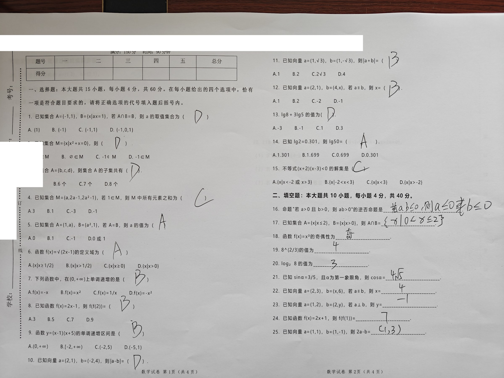
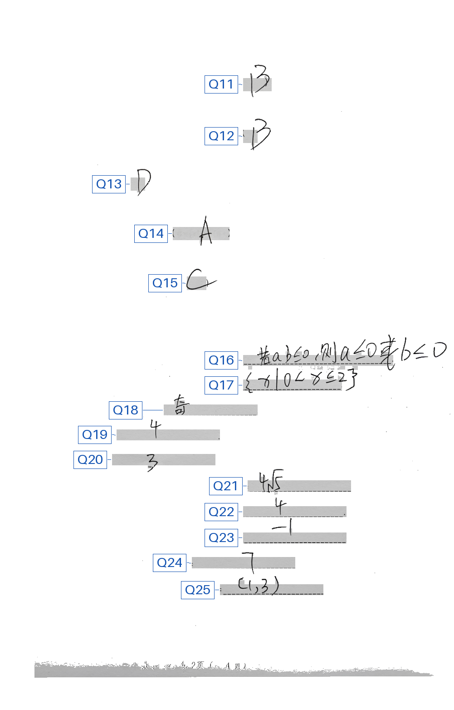
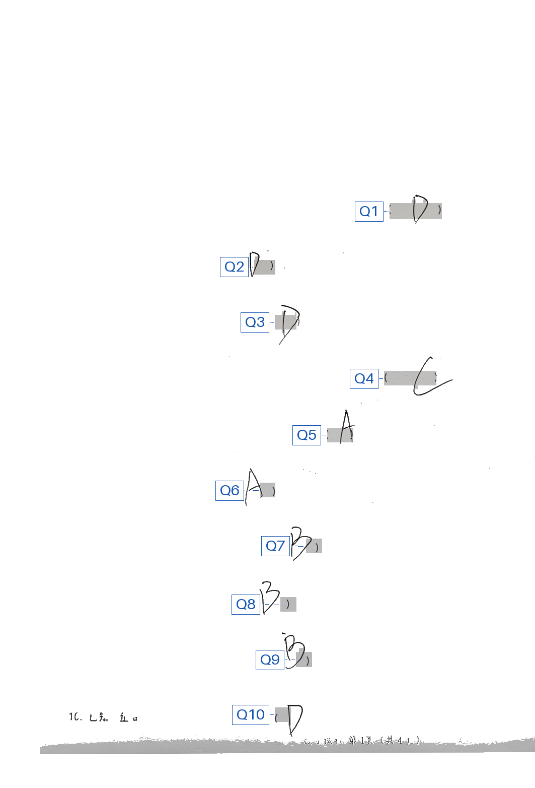

# 03 · 题干上下文泄漏：提示词压不到 0，去掉题干后 0/50

## 回答什么问题

模型会不会**把学生写错的答案改成正确答案**？如果会，是提示词的问题，还是输入里有没有题干的问题？

## 实验设计

同一张原图（`samples/S01_paper_raw.jpg`，含印刷题干与选项），
同一条生产转录线路（`services.ocr_service._call_vision_request`，`qwen3.8-flash`，关闭思考，生产参数不变），
**只换提示词或输入形态**，每个条件各跑 50 次，共 200 次（2026-11-01 采集）。

探针题：Q21「已知 sinα=3/5，且 α 为第一象限角，则 cosα=____」。
学生**故意写的是 `4√5`**，标准答案是 `4/5`。

| 条件 | 提示词（原文） | 输入 |
|---|---|---|
| P1 | `转录这份试卷，不要看题干，不要计算，直接转录。` | 原图（有题干） |
| P2 | `转录这份试卷。` | 原图（有题干） |
| P3 | `把这份试卷上学生的作答内容转录成 JSON，题号用 question_number，答案用 student_answer。只输出 JSON。` | 原图（有题干） |
| 对照 | 同 P2 | 差分图（题干已被减掉） |

P2/P3 **没有**任何防猜规则；P1 只有一句口语化的「不要看题干，不要计算」，没有生产提示词「题干不能作为转录依据」那种明确规则——这就是「灰提示词」：不正式提醒风险，也不诱导。

## 样本（均已脱敏）

原卷（含印刷题干与选项；卷头学校名已遮盖，密封线手写姓名栏已覆盖，图中只剩印刷标签）：



差分后的两栏（印刷题干已被减掉，只剩学生笔迹与蓝色 Q 题号标签）：




同一张卷的第 21 题：学生手写 `4√5`，标准答案是 `4/5`。可以直接在原卷上找到这道填空题核对。
图片与 [`../01_difference-vs-raw`](../01_difference-vs-raw/) 用的是同一份已脱敏素材。

## 结果（每条件 50 次）

| 条件 | 写成标准答案 `4/5` | 写成 `4√5/5` | 抄 `4√5` 但加注「应为4/5」 | 如实只抄 `4√5` | 没给 Q21 答案 |
|---|---|---|---|---|---|
| P1 灰提示词 | **23** | 2 | 12 | 2 | 11 |
| P2 裸一句 | **46** | 2 | 0 | **0** | 2 |
| P3 结构化 JSON | 0 | 8 | 0 | 42 | 0 |
| 差分对照（无题干） | **0** | 0 | 0 | **50** | 0 |

P1 那 11 次「没给答案」里，1 次只回了一句「好的，这是您要求的试卷转录内容。」，10 次原样输出了空白横线（`cosα=______`）——模型把学生写的 `4√5` 整个漏掉了，同样不是如实转录。

更正（2026-11-12，按 `receipts.json` 逐次复核）：P1 一行原记为 33 / 2 / 2 / 2 / 11。第 5、8、9、15、18、23、27、30、38、50 次其实照抄了 `4√5`，只是后面加注「应为4/5」（第 23 次是「通常应为4/5，但按原样转录」），原表误记进了「写成 `4/5`」。现为 23 / 2 / 12 / 2 / 11：加注一栏的 12 次里 10 次写明「应为4/5」，另 2 次（第 7、19 次）只注「转录保留原样」「按图片手写内容转录」。P2、P3 与差分对照不变。

`receipts.json` 里的 `verdict` 由 `probe.py` 的 `classify()` 生成：只要 Q21 片段里出现 `4/5` 或 `4√5/5` 就记 `drift_to_standard`，所以那里是 P1 35、P2 48、P3 8——那是「被题干带偏」的口径（含加注改正与 `4√5/5`），不是上表「写成 `4/5`」的口径。两种口径下，P2 都没有一次如实只抄 `4√5`。

参考：生产提示词（含「题干、标准答案和数学知识不能作为转录依据」）在原图上 10 次里有 6 次读成 `4√5/5`
（见 [`../01_difference-vs-raw`](../01_difference-vs-raw/)），差分图 0/10。

## 两个值得看的原始回执

- P1 第 7 次：模型先抄出 `4√5`，紧接着自己补了一句「*(注：此处手写答案疑似有误，转录保留原样)*」——它在替学生改答案。
- P2 第 1 次：直接输出「则 `cosα = 4/5`」，学生的 `4√5` 完全消失。

## 结论

1. **改答案是真实存在的失败模式**，不需要诱导提示词，中性提示词就能触发：P2 裸一句 50 次里 46 次直接写成 `4/5`，
   另 4 次也没抄对（2 次 `4√5/5`、2 次没给答案），**没有一次如实只抄 `4√5`**；
2. **提示词只改变概率**：原图上试过的 4 种提示词（本组 3 种 + 01 的生产提示词）被带偏 8/50–50/50，没有一种是 0。
   生产提示词的 6/10 来自 01 的另一轮实验；本组不含防猜规则、只要 JSON 的 P3 是 8/50。每格 50 次仍然分不清提示词
   之间谁更好（95% 区间互相重叠），能确定的只是没有一种到 0；P1 那句「不要看题干」在 50 次里只换来 2 次如实；
3. **去掉题干是这组实验里唯一做到 0 的改动**：同一句「转录这份试卷」，给差分图（题干被减掉）就是 0/50
   （01 里生产提示词配两种差分图另有 0/20）。原图与差分的差距是显著的（Fisher 单侧 p≈1×10⁻²⁹），但 0/50 的
   95% 置信上限仍约 5.8%（合计 0/70 约 4.2%），只能说这道题上没再出现，不能说发生率为 0。
   模型没有可借用的上下文，只能认字——判断完全落在识别能力上。

就算将来模型不再被题干带偏，差分仍然划算。同一句提示词、同一道卷：

| 输入 | 输出长度（均值 / 中位） | 耗时（均值 / 中位） |
|---|---|---|
| 原图（含题干） | 2556 / 2302 字符 | 21.5 / 20.2 s |
| 差分（无题干） | 468 / 501 字符 | 5.0 / 4.3 s |

输出短约 5.5 倍、耗时约 4.3 倍（按中位数是 4.6 倍与 4.7 倍）：模型不用读题干，也不用把题干再抄一遍。
原图组有 2 次输出成 1 万字符以上的 HTML（47.7 s、45.4 s），均值被它们拉高，所以均值与中位数并列给。
这 200 次请求全部 `ok: true`，没有剔除失败；但 `_call_vision_request` 内部带一次自动重试，
回执没有记录是否发生过重试（本轮日志里出现过 1 次 ConnectTimeout 后重试成功）。
换成生产提示词是 18.6 s → 8.2 s（见 [`../01_difference-vs-raw`](../01_difference-vs-raw/)，
每路 10 次的汇总均值；01 的回执没有保存逐次耗时）。

这也是为什么生产链路用模板差分而不是原图：不是为了让图更清楚，而是为了让题干在输入阶段就不存在。

## 复算

```bash
python evidence/03_prompt-context-leak/probe.py 50
```

脚本会重新发 200 次请求（3 种提示词 ×50 + 差分对照 ×50），把原始回执写到 `receipts_<时间戳>.json`
（**不覆盖**已提交的 `receipts.json`），并打印归类。成本约 0.8 元（按量 Flash，实测每次约 3.7K 输入 + 0.6K 输出）。
脚本 `import config`，所以需要一份能通过应用启动校验的 `.env`（至少 `DASHSCOPE_API_KEY` 和 `JWT_SECRET`）。

## 边界

- 单张图、单题（Q21）探针，衡量的是**机制是否存在**，不是跨题型的改答案率；
- 差分图和原图的差别不只是题干：选项与页眉也被减掉，并且是两栏裁剪加蓝色 Q 标签。本组没有单独隔离「只去题干」这一个变量；
- 全部为教师自印测试卷，不含真实学生数据；卷头与密封线身份区已遮盖，遮盖后该处无可见笔迹。200 条回执逐条扫过：手机号、校名、考号、姓名 0 命中；
- 未测其他模型的同类行为；本组只证明 `qwen3.8-flash` 在当前提示词语义下的表现；
- 上一轮每条件 10 次（共 40 条）的方向与本轮一致，但分档比例有出入（裸提示词 8/10 → 46/50、灰 6/10 → 23/50），单格 10 次的波动比直觉大——这也是把样本加到 50 的原因。