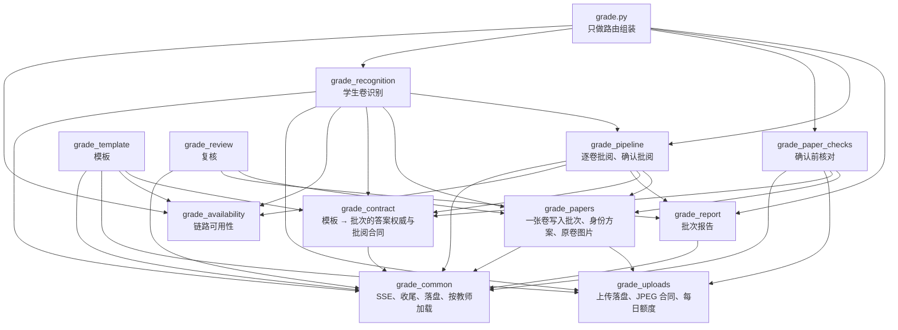

# 批改接口阅读地图（routers/grade*.py）

所有 `/api/batch-grade/...` 接口都在这一组文件里。这份说明讲三件事：

- 一次批改按时间顺序经过哪些接口；
- 每个文件管什么；
- 读代码时从哪里看起。

其他 routers 不在本文范围内。

## 一次批改的完整过程

| 步骤 | 老师在做什么 | 接口 | 文件 |
|---|---|---|---|
| 0 | 打开批改页，看链路是否可用 | `GET /batch-grade/availability` | grade_availability |
| 1 | 导入模板：识别模板页、分栏定位、改题号、确认 | `POST /batch-grade/template/recognize`，`.../cut-candidates`，`.../layout-overrides`，`.../questions`，`POST /batch-grade/template/confirm` | grade_template |
| 2 | 上传学生卷并识别（SSE 流），断线后续识别 | `POST /batch-grade/recognize`，`POST /batch-grade/{batch_id}/recognize/resume` | grade_recognition |
| 2′ | 识别过程中，每张卷一识别完就开始批阅 | （没有单独的接口，由识别流启动） | grade_pipeline |
| 3 | 确认前逐张核对：身份候选、方向、排除失败卷、看原卷 | `GET .../identity-options`，`GET .../orientation`，`POST .../paper/{paper_id}/exclude`，`POST .../paper/{paper_id}/orientation-confirm`，`GET .../paper/{paper_id}/image` | grade_paper_checks |
| 4 | 确认批阅：剩下的卷按冻结的合同批完（SSE 流） | `POST /batch-grade/confirm` | grade_pipeline |
| 5 | 批阅后复核：人工判定、作废、入档、导出 | `/batch-grade/review/...` | grade_review |
| 6 | 看批次报告（后台生成） | `GET /batch-grade/report/{batch_id}` | grade_report |

## 文件分层

每个文件只导入在它上面的文件，不会反过来导入。`tests/test_grade_layers.py` 会检查这一点。

grade.py 为了兼容旧名字，还从其余各层导入，图中省略了这些线。

| 文件 | 行数 | 负责什么 | 从哪里读起 |
|---|---:|---|---|
| grade_common.py | 231 | 各流程共用的底层：`_sse` 生成一条 SSE 事件；`_settle_template_component` 等后台任务收尾，不怕取消；`_save_quick_batch_meta` 在事件循环外写批次快照；`_load_owned_*` / `_locked_owned_*` 只给模板或批次的主人加载，带锁的版本在锁内重新读取 | 文件内按四段排列 |
| grade_uploads.py | 348 | `_save_batch_uploads` 在大小和数量限制内把上传写到磁盘；浏览器 `.ocr-ready-v1.jpg` 合同的检查只读文件头；`_check_limits_or_raise` 查每日图片额度 | `_save_batch_uploads` |
| grade_availability.py | 335 | 现在能不能接活：存储、视觉识别、数学批改、识别配额，需要时加上加速节点。`_require_*` 在创建或改动批改任务前做关口，不可用就返回 503 | `_require_batch_grade_chain` |
| grade_report.py | 263 | 批次报告：后台先整理知识点，再请模型写报告；批阅数据在此期间变过就重新排队 | `_start_batch_report_generation` |
| grade_contract.py | 454 | 本批次按什么答案批：模板是否仍适用、模板证据怎样变成识别缓存、批次答案表、钉住答案的批阅合同 | 文件内三段：模板 / 批次答案表 / 批阅合同 |
| grade_papers.py | 805 | 一页识别结果怎样变成一张试卷：身份、方向、题目，或待复核的占位；批阅前的检查与身份方案；原卷图片 | `_apply_ocr_outcome` → `_ingest_recognized_paper` |
| grade_pipeline.py | 1267 | 批阅只有一条路径 `_grade_paper_core`。逐卷流水线 `_PerPaperGradingPipeline` 在识别过程中每完成一张就批一张；`_grading_events` 是确认批阅的 SSE 流，把剩下的批完 | 文件开头的说明，然后 `batch_grade_confirm` |
| grade_paper_checks.py | 784 | 确认前核对试卷的 5 个接口；方向确认可以带一张转正后的图，触发对这一张的重识别 | `_confirm_orientation_locked` |
| grade_recognition.py | 1423 | 两条识别流（首次与续识别）共用一套实现：`_RecognitionLease` 管资源，`_RecognitionRun` 管进度，`_RecognitionFlavor` 记下两条流故意不同的地方 | 文件开头的说明，然后 `_initial_recognition_events` |
| grade.py | 249 | 只把上面 5 个子路由按原顺序装起来；为旧代码和测试保留从 `routers.grade` 导入旧名字的入口 | 文件开头的说明 |
| grade_template.py | 4154 | 模板导入的全部接口（尚未拆分，是下一个目标） | `batch_grade_template_recognize` |
| grade_review.py | 968 | 批阅后的复核、作废、入档与导出 | `batch_grade_save_manual_review_decision` |

## 读代码时的几个约定

- **状态存在哪里。**
  - 批次状态是 `services.quick_grader.QuickBatch`，存成 `uploads/quick_batch_{id}/meta.json`。
  - 模板状态是 `services.template_session.TemplateSession`，存成 `uploads/template_{id}/meta.json`。
  - 两者都是先写临时文件再原子替换（tmp + `os.replace`）。改动前要先拿 `batch_operation_lock`，拿到锁后重新读取。
- **`_require_*` 是关口。** 条件不满足就抛 HTTPException，宁可停下也不猜（fail closed）。读主流程时可以先跳过它们的函数体。
- **`*_events` 是 SSE 生成器。**
  - 每条事件都经过 `_sse` 生成，等待时按 `_GRADE_HEARTBEAT_SECONDS` 发心跳。
  - 客户端断开时，需要做完的收尾（落盘、关闭流水线）放在单独的任务里，由 `_settle_template_component` 等它结束，再次取消也不会打断。
- **日志名。** 从 grade.py 搬出来的代码仍用 `logging.getLogger("routers.grade")`，所以日志来源名和拆分前一样。
- **旧名字。** `routers.grade.X` 仍然可以导入，但新代码请直接从定义它的文件导入。

## 测试里替换全局量

- 这一组文件各自绑定了 `UPLOAD_DIR` 等名字。如果只 patch `routers.grade` 上的那份，搬走的代码就看不到。
- `tests/patch_reach.py` 会让这种"打不到读取方"的 patch 直接失败，并点名漏掉的模块。
- 需要替换的名字有好几个模块在读时，用 `tests/grade_family.py` 的 `set_grade_global(monkeypatch, name, value)`，它会打到 grade 族里所有读这个名字的模块。
- 只有一个模块在读时，直接 patch 那个模块即可。
